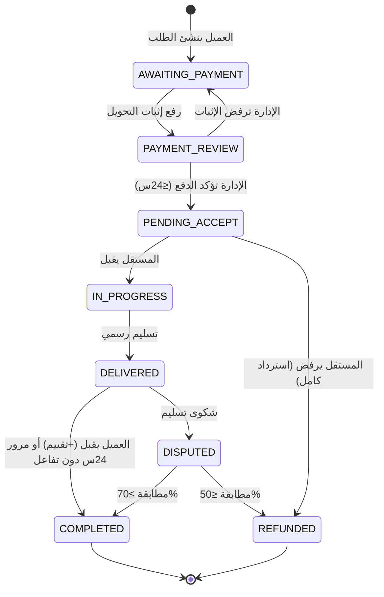

# دورة حياة الطلب

## قواعد
- الانتقالات تتم في Cloud Functions فقط، ولا يكتب العميل `state` مباشرة.
- يبدأ العداد التنازلي عند `IN_PROGRESS`.
- «الاسترداد الكامل» عند رفض المستقل يشمل عمولة العميل (5%).
